# Próxima Etapa – API de Cursos (Containerização com Docker)

Cloud Native – Entrega 2 – Projeto Interdisciplinar 3º ADS – 2º Semestre 2026

**Integrantes:** Julia Basilio · Maria Eduarda Olo · Davi Bigotto · Luis Felipe Trindade

## 1. Descrição

API REST em Node.js que fornece informações de cursos da Próxima Etapa, integrada a um banco PostgreSQL. Um terceiro container, o pgAdmin, permite administrar o banco pelo navegador. Todos os dados são fictícios (LGPD).

Conceitos aplicados: isolamento, portabilidade, imagens, volumes e redes de containers.

## 2. Arquitetura

[Navegador / curl / App]
|
| porta 3000
v
+---------------+ rede: proxima-net +-------------------+
| api (Node) | ------------------------------> | db (PostgreSQL) |
| proxima-api | host = “db”, porta 5432 | proxima-db |
+---------------+ +---------+---------+
|
volume: pgdata
+-----------------+ (persistência)
| pgadmin | ---- rede: proxima-net ----> db:5432
| proxima-pgadmin|
+-----------------+
^
| porta 5050 (host)
[Navegador]


| Serviço | Imagem | Porta (host) | Função |
|---|---|---|---|
| api | Build próprio (`api/Dockerfile`, base `node:20-alpine`) | 3000 | API REST de cursos |
| db | `postgres:16-alpine` | não exposta (5432 interna) | Banco de dados com volume |
| pgadmin | `dpage/pgadmin4` | 5050 | Administração web (opcional) |

- **Rede customizada:** `proxima-net` (bridge). A API acessa o banco pelo nome do serviço (`DB_HOST=db`).
- **Volumes:** `pgdata` (PostgreSQL) e `pgadmin-data` (pgAdmin).
- **Variáveis de ambiente:** definidas no `.env` (não versionado).
- **Healthcheck:** a API só inicia depois que o banco estiver pronto.

## 3. Estrutura de arquivos

proxima-etapa-docker/
├── api/
│ ├── Dockerfile
│ ├── .dockerignore
│ ├── package.json
│ └── server.js
├── db/
│ └── init.sql
├── docs/
├── docker-compose.yml
├── .env (não versionado)
├── .env.example
├── .gitignore
└── README.md


## 4. Boas práticas aplicadas

- Imagem base enxuta (`node:20-alpine`).
- `.dockerignore` (exclui `node_modules`, `.git`, `.env`).
- Camadas otimizadas: `package.json` copiado antes do código para aproveitar o cache.
- Dependências só de produção (`npm install --omit=dev`).
- Usuário não-root (`USER node`).
- Consultas SQL parametrizadas (previne SQL Injection).

## 5. Pré-requisitos

Docker Engine, Docker Compose v2 e Git.

```bash
docker --version
docker compose version
```

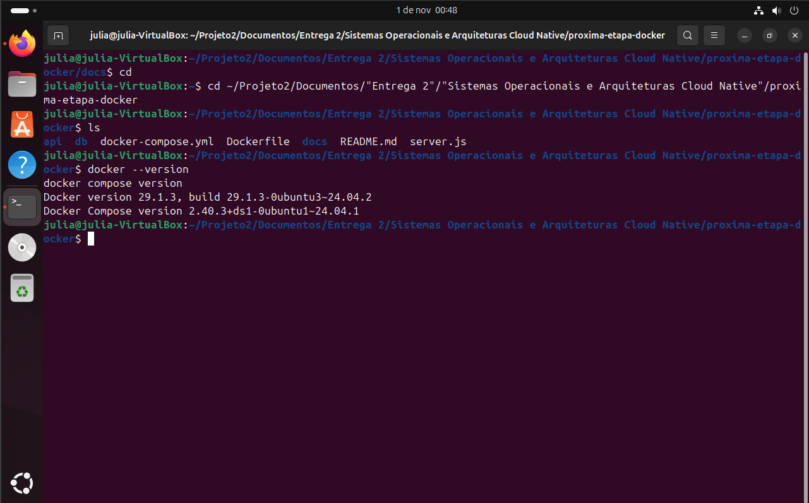

## 6. Como buildar e rodar

```bash
git clone <URL-DO-REPOSITORIO>
cd <PASTA-DO-REPOSITORIO>/cloud-native
cp .env.example .env
nano .env
docker compose up --build -d
docker compose ps
```

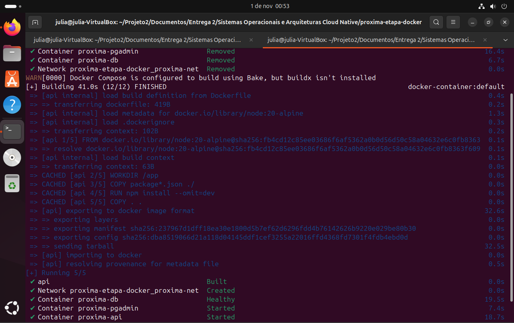

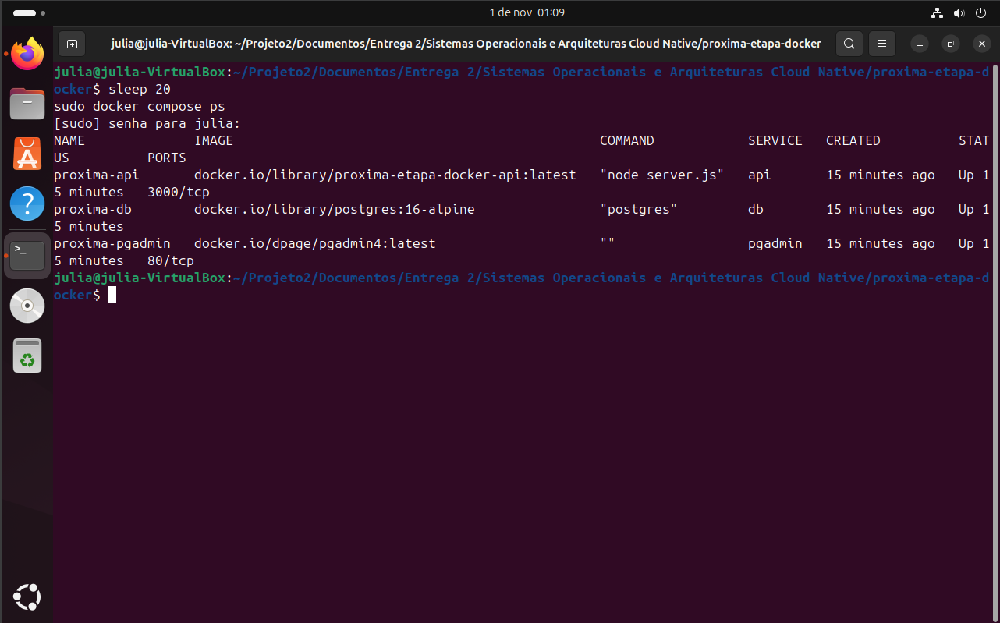

Para parar:

```bash
docker compose down
docker compose down -v
```

`down -v` também remove os volumes e **apaga os dados**.

## 7. Portas expostas

| Porta | Serviço | Acesso |
|---|---|---|
| 3000 | api | http://localhost:3000 |
| 5050 | pgadmin | http://localhost:5050 |
| 5432 | db | não exposta (apenas na rede `proxima-net`) |

## 8. Endpoints

| Método | Rota | Descrição |
|---|---|---|
| GET | `/health` | Verifica API e conexão com o banco |
| GET | `/cursos` | Lista os cursos |
| POST | `/cursos` | Cadastra curso (`nome`, `local`, `carga_horaria` inteiro > 0) |

## 9. Como testar

### 9.1 Saúde da API

```bash
curl http://localhost:3000/health
```

Esperado: `{"status":"ok","database":"connected"}`

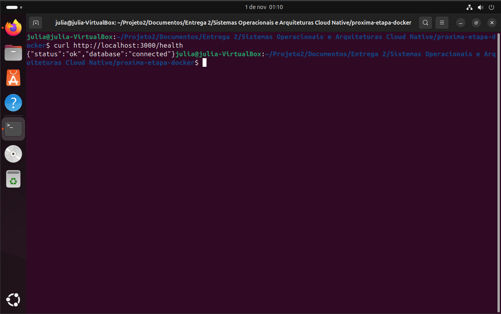

### 9.2 Listar cursos

```bash
curl http://localhost:3000/cursos
```


### 9.3 Cadastrar curso

```bash
curl -X POST http://localhost:3000/cursos \
  -H "Content-Type: application/json" \
  -d '{"nome":"Teste de Perfil","local":"Online","carga_horaria":10}'
```

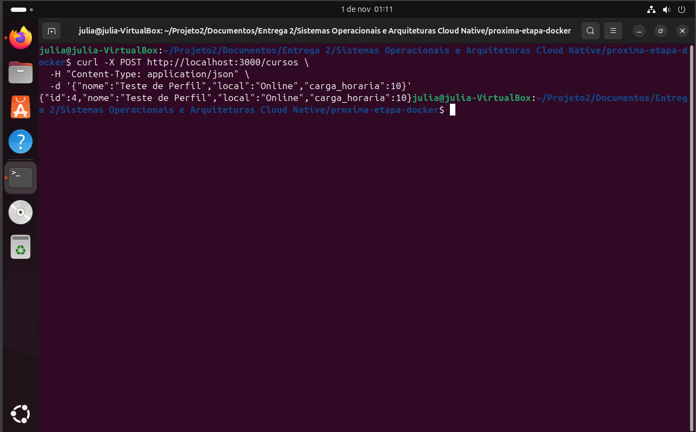

### 9.4 Validação (entrada inválida)

```bash
curl -X POST http://localhost:3000/cursos \
  -H "Content-Type: application/json" \
  -d '{"nome":"","carga_horaria":-5}'
```

Esperado: erro 400.

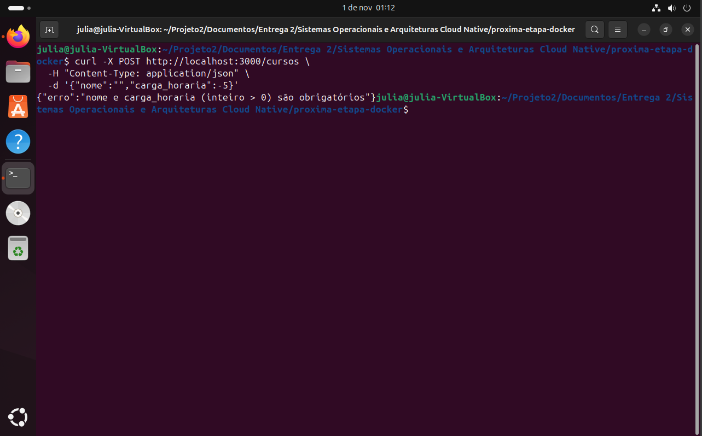

### 9.5 Persistência (volume)

```bash
docker compose down
docker compose up -d
curl http://localhost:3000/cursos
```

O curso "Teste de Perfil" deve continuar na lista.

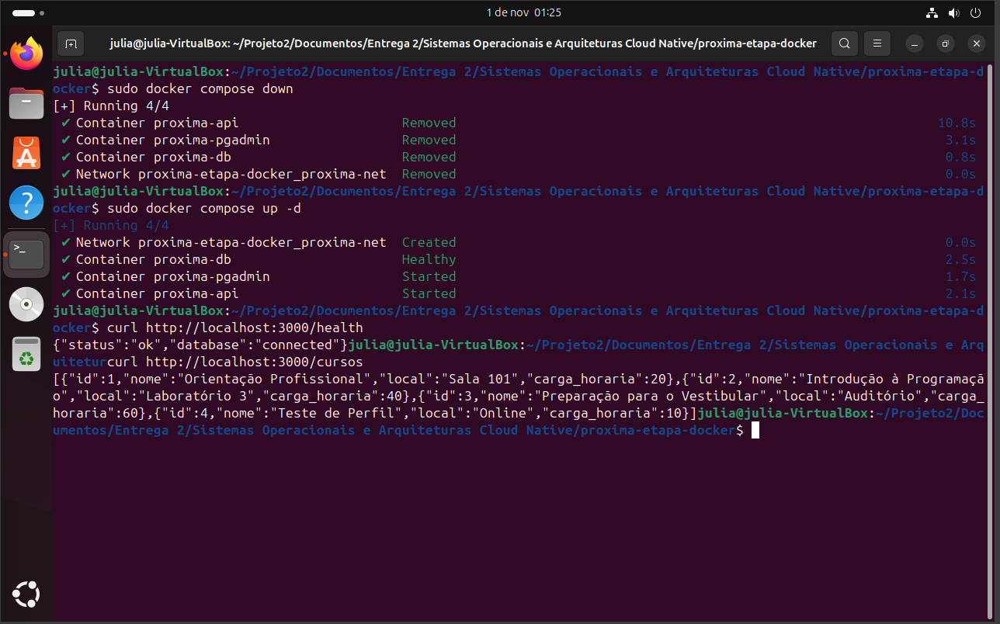

### 9.6 pgAdmin

1. Abra http://localhost:5050 e faça login com `PGADMIN_EMAIL` e `PGADMIN_PASSWORD`.

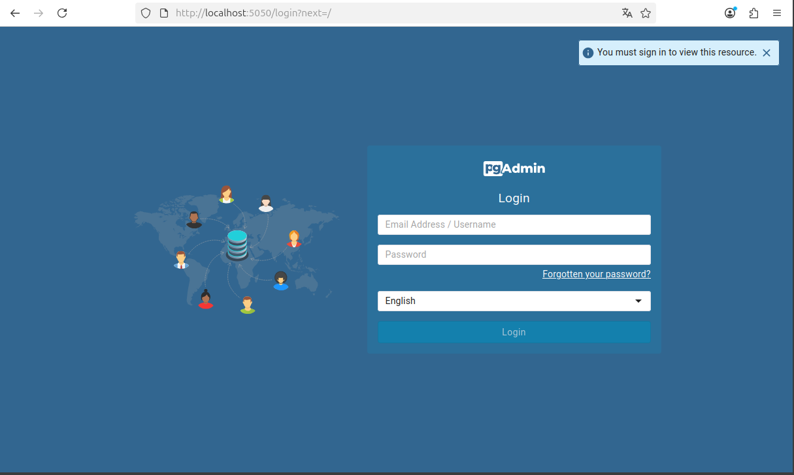

2. *Add New Server* → aba *Connection*: Host `db`, Port `5432`, Maintenance database = `DB_NAME`, Username e Password = `DB_USER` e `DB_PASSWORD`.

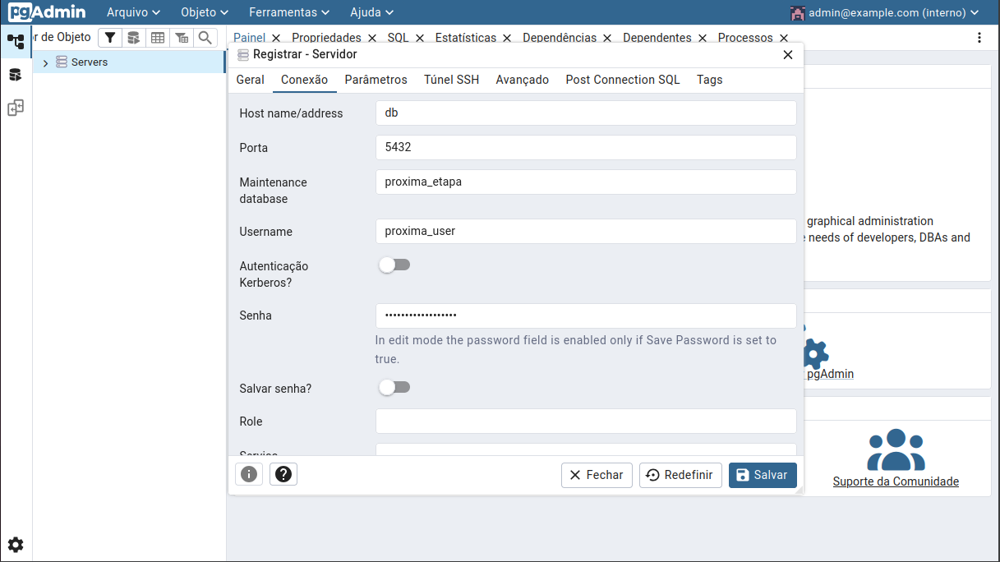

3. Navegue até *Databases > (banco) > Schemas > public > Tables > cursos* e visualize os dados.

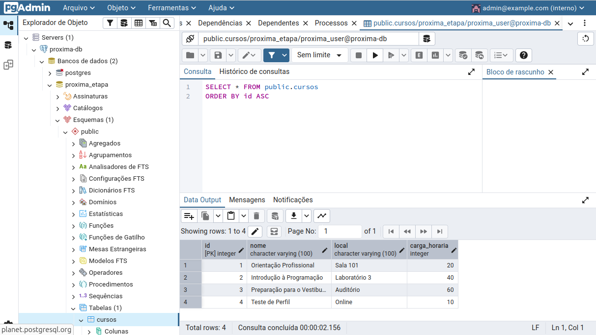

### 9.7 Logs

```bash
docker compose logs api
docker compose logs db
```

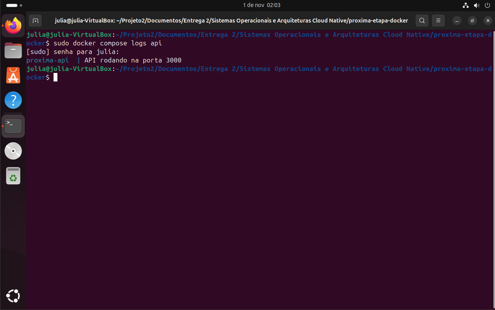

### 9.8 Teste do zero

```bash
docker compose down -v
docker compose up --build -d
curl http://localhost:3000/cursos
```

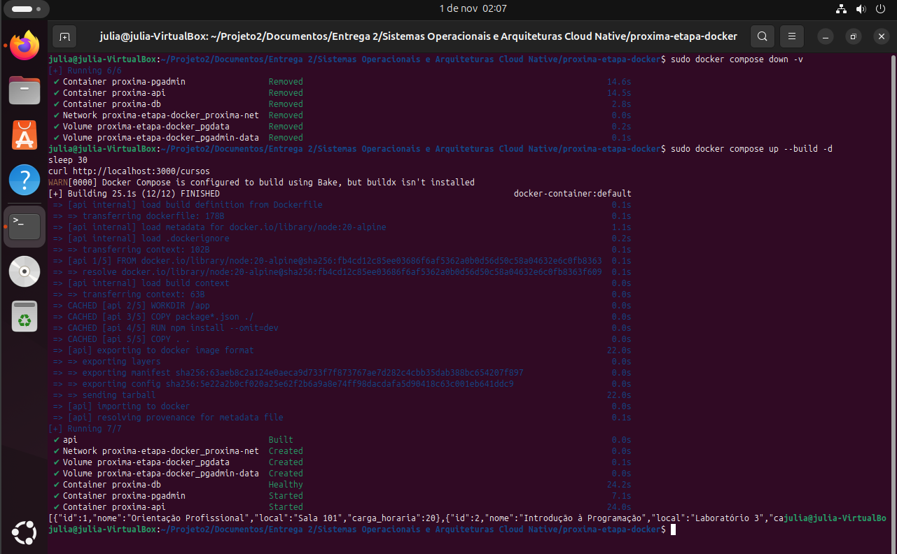

## 10. Variáveis de ambiente

| Variável | Descrição |
|---|---|
| `DB_USER` | Usuário do PostgreSQL |
| `DB_PASSWORD` | Senha do PostgreSQL |
| `DB_NAME` | Nome do banco |
| `PGADMIN_EMAIL` | E-mail de login do pgAdmin |
| `PGADMIN_PASSWORD` | Senha de login do pgAdmin |

O `.env` real não é enviado ao GitHub (`.gitignore`). Use o `.env.example` como modelo.

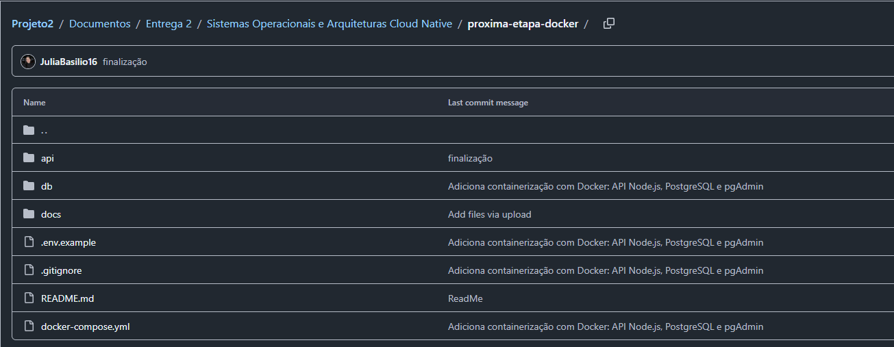

## 11. LGPD e segurança

- Dados fictícios.
- Credenciais fora do código e do repositório.
- Consultas parametrizadas e validação de entrada.
- Porta do banco não exposta ao host.
- Aplicação roda sem privilégios de administrador no container.

